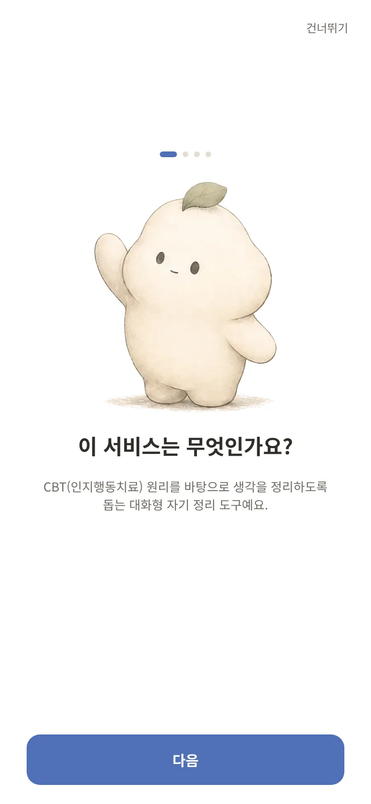
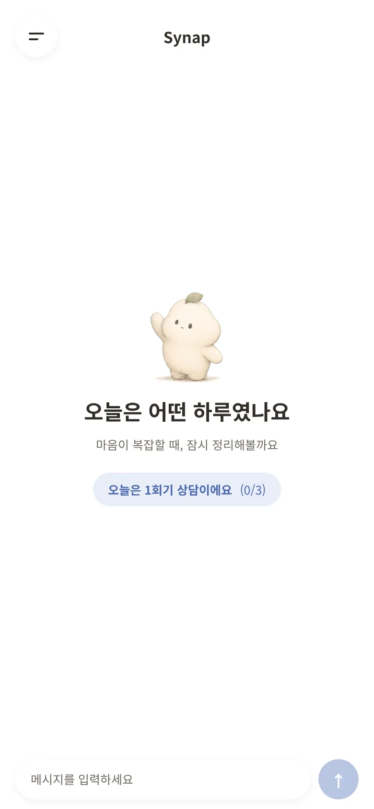
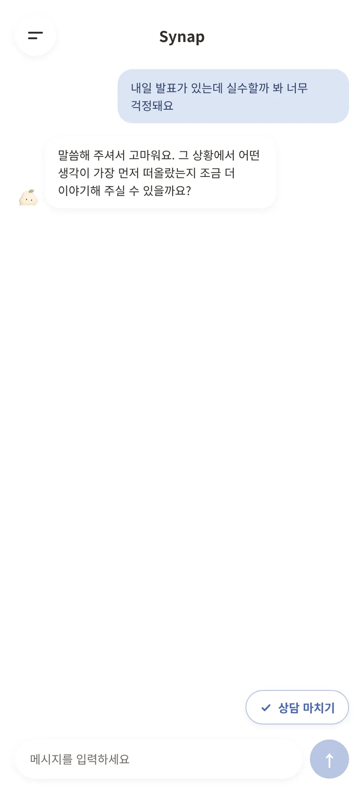
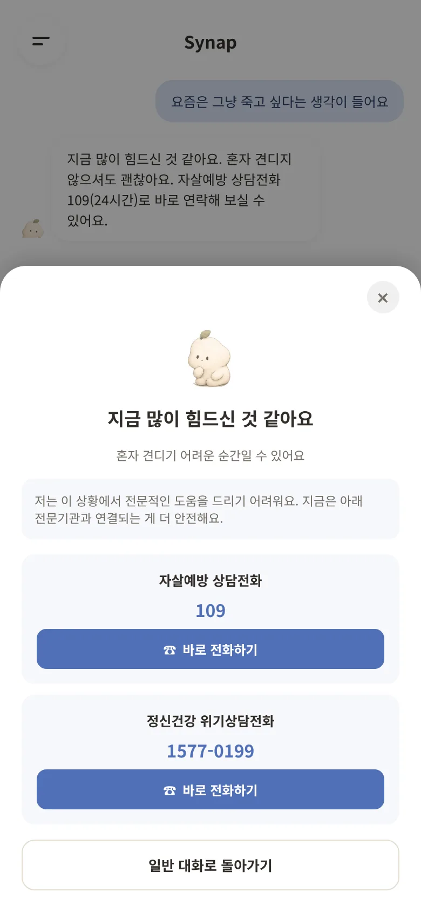
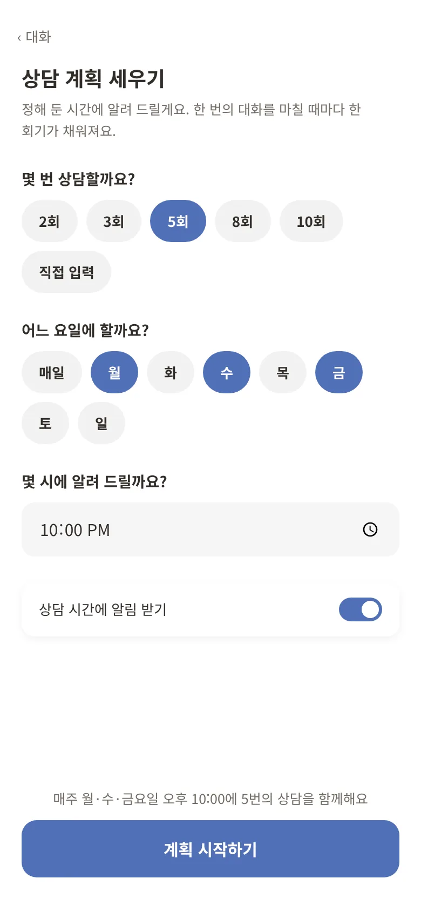
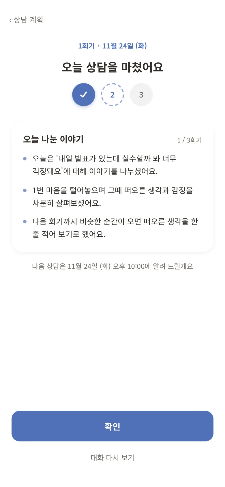
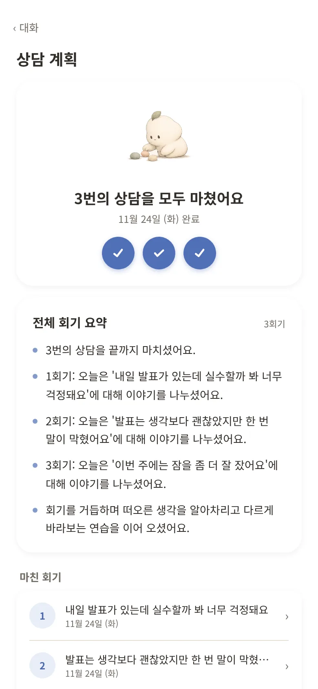
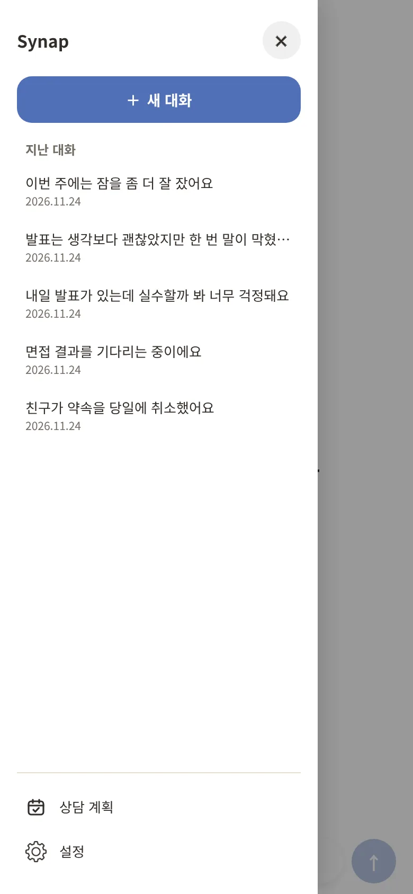
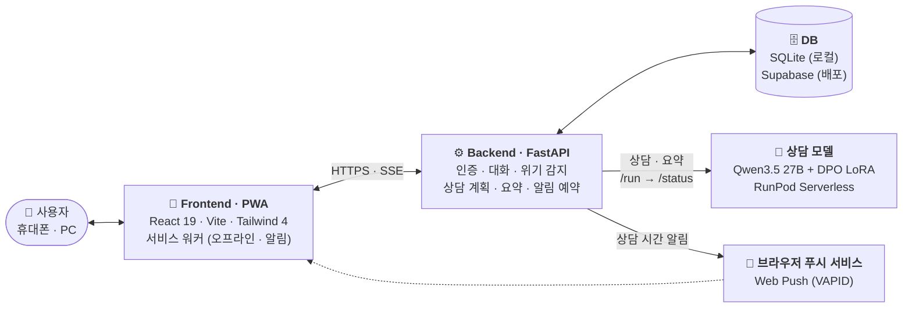
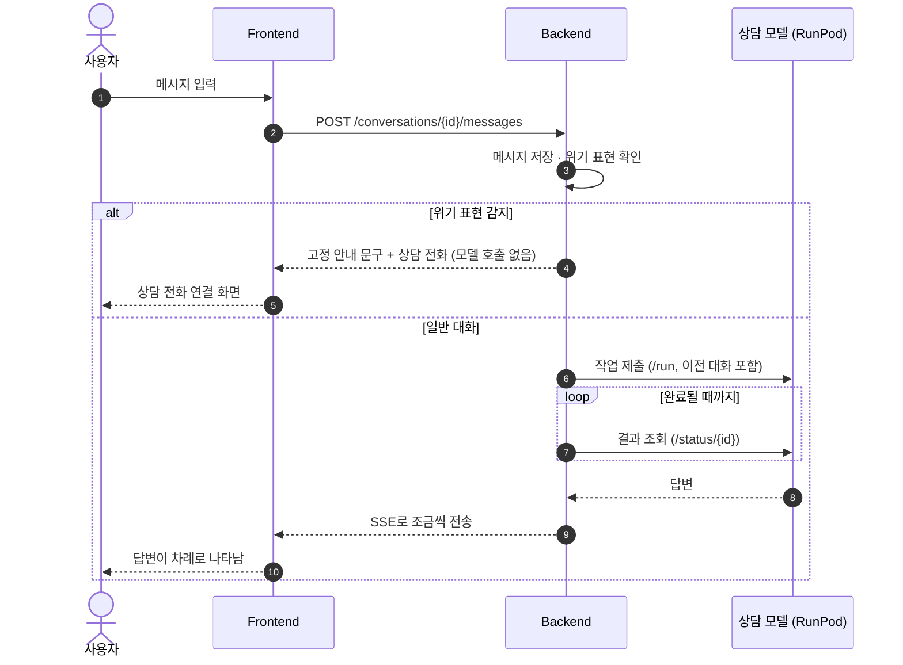

<div align="center">


# Synap

**마음이 복잡할 때, 잠시 정리해 볼까요**

CBT(인지행동치료) 원리를 바탕으로 생각을 함께 정리해 주는 대화형 자기 정리 앱 (PWA)


</div>

> [!IMPORTANT]
> Synap은 전문적인 심리 치료나 상담을 대체하지 않습니다. 대화에서 위기 표현이 감지되면 모델을 거치지 않고 바로 상담 전화(자살예방 상담전화 109, 정신건강 위기상담전화 1577-0199)를 안내합니다.

<br />

## 화면

<table>
  <tr>
    <td align="center"><br /><sub><b>온보딩</b></sub></td>
    <td align="center"><br /><sub><b>새 대화</b> · 오늘의 회기 안내</sub></td>
    <td align="center"><br /><sub><b>대화</b> · 상담 마치기</sub></td>
    <td align="center"><br /><sub><b>위기 안내</b> · 상담 전화 연결</sub></td>
  </tr>
  <tr>
    <td align="center"><br /><sub><b>상담 계획</b> · 횟수·요일·시각</sub></td>
    <td align="center"><br /><sub><b>회기 완료</b> · 도장과 요약</sub></td>
    <td align="center"><br /><sub><b>모든 회기 완료</b> · 전체 요약·타임라인</sub></td>
    <td align="center"><br /><sub><b>메뉴</b> · 지난 대화</sub></td>
  </tr>
</table>

<sub>※ 화면의 상담 답변과 요약 문장은 개발용 목업 모델(<code>LLM_MODE=mock</code>)의 고정 응답입니다.</sub>

<br />

## 주요 기능

| 기능 | 설명 |
|---|---|
| 💬 **CBT 상담 대화** | 팀이 학습한 상담 모델(Qwen3.5 27B, RunPod 서버리스)과 대화합니다. 답변은 SSE로 흘려 보여 줍니다 |
| 🆘 **위기 감지** | 위기 표현(키워드 54개, [초안](docs/crisis-keywords-draft.md))이 나오면 모델을 호출하지 않고 고정 문구와 상담 전화 연결 화면을 띄웁니다. 기록은 사용자와 연결되지 않는 형태로만 남깁니다 |
| 🗓️ **상담 계획 · 알림** | 몇 회기(2·3·5·8·10회 또는 1~12회 직접 입력)를 어느 요일·시각에 할지 정하면 그 시각에 웹 푸시로 알려 줍니다. 2회기부터는 지난 회기를 짚는 인사로 대화를 시작합니다 |
| ✅ **회기 도장 · 요약** | 대화에서 "상담 마치기"를 누르면 회기 도장이 찍히고, 오늘 나눈 이야기를 요약해 줍니다. 모든 회기를 마치면 전체 회기를 돌아보는 요약과 회기 타임라인을 보여 줍니다 |
| 🧠 **이전 대화 기억** | 회기마다 기억용 요약을 저장해 다음 대화에 이어서 씁니다 |
| 👤 **비회원으로 시작** | 가입 없이 바로 쓰고, 나중에 가입하면 대화가 그대로 이어집니다 |
| 📱 **설치형 웹 앱 (PWA)** | 홈 화면에 설치하고, 오프라인에서도 앱이 열립니다 |
| 🔒 **개인정보** | 보관 기간이 지난 기록을 지우는 정리 작업(하루 1회 실행)과 전체 기록 삭제·탈퇴를 지원합니다 |

<br />

## 시스템 구조



대화 한 턴이 처리되는 순서:



- **모델 호출**: `LLM_MODE`로 바꿉니다. `runpod`(팀 모델) · `http`(OpenAI 호환 서버) · `mock`(개발용 고정 응답).
- **모델 서버 보호**: 동시 호출 수와 대기 줄을 제한하고, 너무 오래 걸리면 RunPod 작업을 취소합니다. 몰리면 "지금 이용하는 분이 많아요"로 안내합니다. ([자세히](docs/demo-guide.md#8-모델-호출-보호-동시-호출-제한--타임아웃))
- **배포 계획**: 프론트 AWS CloudFront + S3, 백엔드 AWS EC2(Docker + Nginx), DB Supabase. 아직 배포 설정 파일은 없습니다.

<br />

## 기술 스택

| 영역 | 사용 기술 |
|---|---|
| 프론트엔드 | TypeScript, React 19, React Router 7, Vite 8, Tailwind CSS 4, `vite-plugin-pwa`(Workbox) |
| 백엔드 | Python 3, FastAPI, Uvicorn, Pydantic Settings, `httpx`, `pywebpush` |
| 데이터베이스 | SQLAlchemy 2 + Alembic. 로컬 SQLite, 배포 Supabase(Postgres, `psycopg`) |
| 인증 | 직접 구현한 JWT(PyJWT), 비밀번호 해시는 `scrypt` (비회원 → 회원 전환 지원) |
| 실시간 응답 · 알림 | SSE(Server-Sent Events), Web Push(VAPID) |
| 상담 모델 | Qwen3.5 27B + DPO LoRA, RunPod 서버리스. 호출 방법: [`model/README.md`](model/README.md) |
| 테스트 · 린트 | 프론트: Vitest, Testing Library, oxlint · 백엔드: pytest, ruff |
| 디자인 · 협업 | Figma, GitHub(PR 리뷰), CodeRabbit 자동 리뷰 |

<br />

## 폴더 구조

```
CBT-Chatbot/
├── frontend/                 # PWA 앱 (React + TypeScript + Vite)
│   ├── public/               #   아이콘, 푸시 알림 서비스 워커(push-sw.js)
│   └── src/
│       ├── api/              #   서버 호출 + 백엔드 없이 쓰는 목업(mock*.ts)
│       ├── components/       #   공통 UI (chat/, crisis/, plan/, guest/, auth/)
│       ├── hooks/            #   useChat, useCurrentPlan 등
│       ├── lib/              #   세션·설정 저장, 푸시 구독, 날짜 표기
│       ├── pages/            #   화면 (라우트 하나당 파일 하나)
│       └── assets/           #   마스코트(webp), 아이콘
├── backend/                  # API 서버 (FastAPI)
│   ├── app/
│   │   ├── api/v1/           #   엔드포인트: auth, me, conversations, plans, push
│   │   ├── services/         #   llm(모델 호출) · crisis(위기 감지) · summary · plans · push · retention
│   │   ├── core/             #   설정(.env), 보안, 오류 형식
│   │   └── models.py         #   DB 테이블
│   ├── migrations/           #   Alembic 마이그레이션
│   ├── scripts/              #   모델 API 연결 점검, 푸시 키 생성
│   └── tests/                #   pytest
├── model/                    # 상담 모델 API 사용법 (모델 서빙은 RunPod)
├── docs/                     # API 명세, DB 설계, 시연 가이드, 위기어 초안, README 이미지
└── .env.example              # 환경 변수 예시 (복사해서 .env 로 사용)
```

<br />

## 시작하기

### 1. 화면만 빠르게 보기 (백엔드 없이)

프론트엔드는 기본으로 목업 API를 써서 혼자 실행됩니다.

```bash
cd frontend
npm install
npm run dev        # http://localhost:5173
```

### 2. 전체 실행 (프론트 + 백엔드)

```bash
cp .env.example .env              # 루트에 .env 를 만들고 값을 채운다 (커밋 금지)

cd backend
python3 -m venv .venv && source .venv/bin/activate
pip install -r requirements-dev.txt
alembic upgrade head              # DB 테이블 생성
uvicorn app.main:app --reload     # http://localhost:8000/docs
```

다른 터미널에서 `frontend/.env.local`에 `VITE_USE_MOCK=false`, `VITE_API_BASE_URL=http://localhost:8000/api/v1`을 넣고 `npm run dev`를 실행합니다. 브라우저는 꼭 `http://localhost:5173`으로 엽니다 (CORS).

- 모델 없이 먼저 확인하려면 루트 `.env`의 `LLM_MODE=mock`을 그대로 둡니다.
- 팀 모델에 연결하려면 `LLM_MODE=runpod`와 `RUNPOD_*` 값을 채웁니다. API 키는 `.env`에만 둡니다.
- 상담 시간 알림을 쓰려면 `python scripts/generate_vapid_keys.py`로 만든 키를 `.env`에 넣습니다.

모델 연결 점검, 리허설 체크리스트, 문제 해결은 **[시연 가이드](docs/demo-guide.md)** 에 정리돼 있습니다.

### 테스트

```bash
cd backend
pytest && ruff check .
```

```bash
cd frontend
npm test && npm run lint && npm run typecheck
```

<br />

## 문서

| 문서 | 내용 |
|---|---|
| [docs/api-spec.md](docs/api-spec.md) | REST API · SSE 이벤트 · 상담 계획 · 웹 푸시 명세 |
| [docs/db-schema.md](docs/db-schema.md) | 테이블 설계(ERD), 보관 기간 |
| [docs/demo-guide.md](docs/demo-guide.md) | 실행 · 모델 연결 점검 · 시연 리허설 · 문제 해결 |
| [docs/crisis-keywords-draft.md](docs/crisis-keywords-draft.md) | 위기 감지 키워드 초안과 모의 평가 |
| [model/README.md](model/README.md) | 상담 모델 API 호출 방법 (상담 · 회기 요약 · 전체 요약) |
| [frontend/README.md](frontend/README.md) | 프론트 실행, 목업으로 화면 상태 확인하기, PWA |
| [backend/README.md](backend/README.md) | 백엔드 실행, 마이그레이션, 보관 기간 정리 |

<br />

## 협업 규칙

- `main`에 직접 push하지 않고 **브랜치 → PR → 리뷰 → merge**
- 브랜치 이름: `feat/`, `fix/`, `docs/`, `model/`, `chore/` + 소문자-하이픈
- 커밋 메시지: `종류: 내용` (`feat`, `fix`, `style`, `refactor`, `docs`, `chore`, `test`)
- 비밀 값(API 키, 푸시 개인키, DB 주소)은 루트 `.env`에만 두고 커밋하지 않습니다
- 모델 가중치·데이터셋은 Hugging Face Hub 비공개 저장소에서 관리합니다

<br />

## 현재 상태와 남은 일

- [x] 비회원/회원 인증, 대화 · SSE 스트리밍, 위기 감지, 이전 대화 기억
- [x] 팀 모델(RunPod) 연결, 동시 호출 제한 · 타임아웃
- [x] 상담 계획, 웹 푸시 알림, 회기 · 전체 요약
- [ ] 배포 (AWS + Supabase)와 https 주소 — 아이폰 알림은 배포 후 홈 화면에 설치해야 받을 수 있습니다
- [ ] CI (PR마다 자동 테스트)
- [ ] 위기 문구 · 키워드 · 전화번호 전문가 검토
- [ ] 실제 모델로 회기 · 전체 요약 품질 확인
